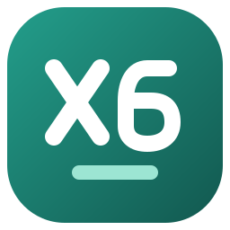
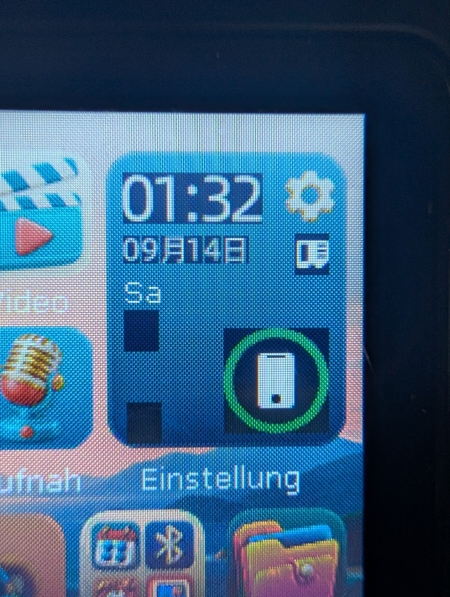

# DDMY X6 - Flasher



Ein übersichtlicher WebUSB-Flasher für den **DDMY X6 mit Actions ATJ2157**.
Firmware sichern, vergleichen und zurückspielen – direkt im Browser.

**[Flasher online öffnen](https://netfreak25.github.io/DDMY-X6-Flasher/)** ·
**[Windows-App herunterladen](https://github.com/Netfreak25/DDMY-X6-Flasher/releases)** ·
**[Bedienungsanleitung](docs/BEDIENUNG.md)**

## Funktionen

| Funktion | Was sie macht |
| --- | --- |
| Sicherung erstellen | MBREC, beide BREC-Kopien und das gesamte LFI als `.x6backup.zip` sichern. |
| Sicherung wiederherstellen | Vollständige ZIP-Sicherungen oder vorhandene Toolkit-Sicherungsordner prüfen und zurückschreiben. |
| LFI-Teilaktualisierung | Eine passende LFI-`.bin` prüfen, den bisherigen Inhalt lokal sichern, schreiben und vollständig zurücklesen. |
| Mit Gerät vergleichen | Die ausgewählte `.bin` mit dem gesamten Firmwarebereich vergleichen und abweichende Bytes zählen. |

„Full“ umfasst **Bootdatensätze und Firmware**, ungefähr 62 MB. Musikdateien,
der übrige NAND-Inhalt und die SD-Karte gehören nicht zur Sicherung.
Alle 148 LFI-Dateiprüfsummen werden geprüft. Unbestätigte Schreibbefehle werden
nicht automatisch wiederholt. Eine fehlgeschlagene Sicherung bleibt ausdrücklich
unvollständig; vorhandene Lesedaten können trotzdem gespeichert werden.

**Vollständige angepasste Firmware umfasst BREC und LFI.** Der einzelne `.bin`-Flash
ist ausdrücklich nur eine LFI-Teilaktualisierung. Für eine vollständige Installation
ist ein passendes Gesamtpaket über die Wiederherstellungsfunktion erforderlich.

## Schnellstart

1. Die **Windows-App** aus der [aktuellen Release](https://github.com/Netfreak25/DDMY-X6-Flasher/releases) herunterladen und das ZIP entpacken.
2. **DDMY X6 Helper.exe** per Doppelklick starten. Chrome wird beim Öffnen bevorzugt. Die Pages-Seite kann auch direkt im bereits geöffneten Chrome-Tab aufgerufen werden.
3. Im Browser **Verbinden** wählen. Die Seite koppelt sich mit der laufenden App, die den Wechsel nach ADFU übernimmt. Danach den X6 im USB-Dialog auswählen. Nach einem längeren Wechsel erscheint dafür **USB-Zugriff erlauben** als zweiter Klick.
4. Eine Sicherung erstellen oder eine eigene Firmware auswählen.
5. Nach der Nutzung die App schließen.

Die App ist portabel, hat ein eigenes Fenster und Taskleisten-Icon und benötigt
keine separate Python-Installation. Sie installiert **keinen Windows-Dienst**,
keinen Autostart und bleibt nach dem Schließen nicht im Hintergrund aktiv.
Die Schaltfläche **Offline öffnen** verwendet die mitgelieferte lokale Website.
Für die direkte Kopplung aus einem Pages-Tab ist mindestens **Helper Beta 2**
erforderlich. Zum Aktualisieren die alte App schließen und die neue EXE starten.

Voraussetzungen: Windows 10/11 (64 Bit), Chrome oder Edge und WinUSB für das
ADFU-Gerät `10D6:10D6`. Der normale USB-Massenspeichertreiber bleibt bestehen.
Bei einem Windows-Zugriffsfehler während des ADFU-Wechsels die App schließen
und über **Als Administrator ausführen** neu starten.

## Wie es arbeitet

Die Website wird über GitHub Pages geladen. Die lokale Windows-App stellt nur
Geräteerkennung, den Windows-SCSI-Wechsel nach ADFU und sechs hashgeprüfte,
generische RAM-Hilfsprogramme bereit. Boot- und Firmwaredaten überträgt der
Browser **direkt per WebUSB** zum Player und zurück.

Die Verbindung zur App läuft ausschließlich über `127.0.0.1`, mit einem zufälligen
Sitzungsschlüssel und einer Prüfung der erlaubten Website-Herkunft. Ein direkt
geöffneter Pages-Tab holt den Schlüssel erst beim Klick auf **Verbinden** über
den festen lokalen App-Port aus `site.json`. Der Kopplungsaufruf prüft Herkunft,
Host und einen eigenen Anfrage-Header und greift noch nicht auf USB zu.
Beim Öffnen durch die App ist zusätzlich die Übergabe im URL-Fragment möglich;
der Schlüssel wird nicht an GitHub übertragen. Chrome kann die Erlaubnis für
den Zugriff auf andere Apps auf diesem Gerät abfragen.

Beim bloßen Öffnen der Seite oder App wird der Player **nicht abgefragt**.
Firmware, Backups und Berichte bleiben auf dem eigenen Rechner. Es gibt keine
Upload-Funktion, Cloud-Sicherung oder Telemetrie.

## Das Gerät

Der **DDMY X6** ist ein kompakter Multimedia-Player mit Touchscreen. Das hier
unterstützte Gerät bietet unter anderem Musik- und Videowiedergabe, Radio,
Aufnahme, Bluetooth, E-Books und microSD-Unterstützung.

| Merkmal | Unterstützte Variante |
| --- | --- |
| Marke / Modell | DDMY X6 |
| Prozessor | Actions ATJ2157 |
| Display | 240 × 320 Pixel, Hochformat |
| Interner Speicher | 4-GB-NAND; normales internes USB-Laufwerk mit 3.835.691.008 Byte |
| NAND-Kennung | `2C 68 04 4A A9` |
| USB normal / ADFU | `10D6:1101` / `10D6:10D6` |
| LFI-Größe | 61.657.088 Byte |

Andere Geräte mit dem Namen „X6“ oder gleicher Gehäuseform können andere
Hardware enthalten. Das Profil ist auf die oben genannte Variante begrenzt.



*Nahaufnahme des Testgeräts mit angepasster Oberfläche. Foto mit Zustimmung
des Eigentümers veröffentlicht; die abgebildete Firmware ist nicht enthalten.*

## Pakete und Prüfstand

- **Windows-Helper-ZIP:** portable App, Offline-Oberfläche und genau sechs
  generische Hilfsdateien: `adfus.bin`, `fwsc.bin`, `nandhwsc.bin`,
  `nandinfo.bin`, `nandread.bin`, `vram_last.bin`.
- **Source-ZIP:** der veröffentlichte Programmcode, Tests, Icons und Anleitung.
- **Nicht enthalten:** vollständige oder modifizierte Gerätefirmware, Dumps,
  persönliche Sicherungen, gerätespezifische Serienkennungen oder
  Reverse-Engineering-Unterlagen.

**Beta / unverifizierter Build-Kandidat:** Protokoll, Dateiabläufe und Oberfläche
sind automatisiert mit simuliertem USB und künstlichen Testdaten geprüft. Der
neue Browserweg ist noch nicht am X6 auf Hardware bestätigt. Die bisherige
native Flash-Routine wurde als Grundlage übernommen.

Full Restore bleibt eine ausdrücklich zu bestätigende **Notfall-Wiederherstellung**:
Die Wirkung des Boot-Schreibbefehls auf beide BREC-Kopien ist noch nicht vollständig
belegt. Nur bytegleiches Rücklesen aller Bestandteile ergibt „vollständig verifiziert“.

## Entwicklung

```text
npm ci --ignore-scripts
npm test
npm run test:ui
npm run lint
python -m unittest discover -s tests -q
ruff check tools tests
```

Die Tests benötigen keine Dateien eines echten Players und greifen nicht auf
Hardware zu. Für einen lokalen EXE-Build werden Python 3.11, PyInstaller 6.22.3
und die sechs freigegebenen Hilfsdateien im lokalen Runtime-Verzeichnis benötigt:

```text
python tools/build_helper.py
```

Die Build-Ausgabe bleibt unter dem ignorierten Verzeichnis `private_dumps/`.
Abhängigkeiten und Hinweise: [THIRD_PARTY.md](THIRD_PARTY.md).
